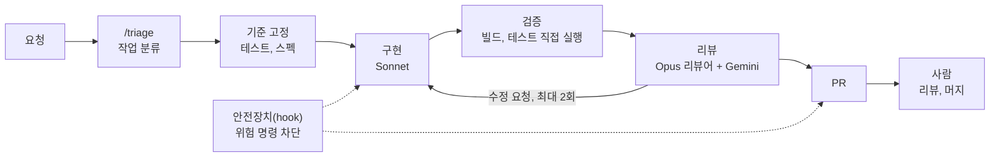

# AI 개발 하네스

이 레포에는 AI 코딩 도구(Claude Code)가 이 프로젝트에서 안전하게 일하도록 만든 전용 작업 환경(하네스)이 있다. 하네스는 AI에게 프로젝트 규칙과 작업 절차를 주고, 결과가 맞는지를 테스트로 판정하며, 위험한 명령은 실행 직전에 막는다. 이 문서는 무엇을 왜 만들었는지, 실제 작업에서 어떤 효과가 있었는지를 정리한다.

## 문제

AI 코딩 도구를 설정 없이 그대로 쓰면 이 프로젝트에서 다음 문제가 생긴다.

- **완료를 판단할 기준이 없다**: "고쳐 줘"라고 맡긴 결과가 맞는지 확인하려면 사람이 바뀐 코드를 처음부터 다시 읽어야 한다.
- **기존 동작이 모르는 사이에 바뀐다**: AI가 리팩토링하면서 실패하는 테스트를 구현에 맞춰 고치면, 테스트가 통과해도 동작이 바뀌었는지 알 수 없다.
- **위험한 일을 할 수 있는 권한이 있다**: 한 레포에 Terraform, 배포 워크플로우, 비밀 값 파일, 공유 브랜치가 함께 있다.
- **같은 모델이 자기 코드를 검토한다**: 코드를 작성한 AI가 같은 맥락에서 검토하면 같은 실수를 놓친다.

## 핵심 아이디어

작업을 **완료 기준을 어디서 얻을 수 있는지**에 따라 세 그룹으로 나누고, 그룹마다 AI에게 맡기는 범위를 다르게 정했다.

| 그룹 | 작업 | 완료 기준 | AI가 맡는 범위 |
|---|---|---|---|
| A | 리팩토링, 버그 수정 | 레포 안에 있다(기존 동작, 기대 동작) | 기준 테스트 작성부터 PR까지 |
| B | 기능 개발, 조사/문서 | 사람이 새로 정해야 한다 | 스펙 초안, 사람이 승인한 뒤 구현 |
| C | 인프라/배포, 성능 | 실제 환경에서만 확인된다 | 변경 초안, 로컬 검증, 측정까지 |

어느 그룹이든 구현 전에 기준(테스트, 승인된 스펙, 측정 기준선)을 먼저 커밋하고 그 뒤로는 바꾸지 않는다. 그래서 리뷰하는 사람은 기준 테스트와 그 통과 여부부터 확인하면 된다.

## 하네스 구성

| 구성 요소 | 하는 일 | 위치 |
|---|---|---|
| 규칙 | 빌드 명령, 계층 규칙, 금지 사항, 문서 작성 규칙을 AI가 작업을 시작할 때 읽는다 | `CLAUDE.md`(루트, 서비스별, `infra/`) |
| 작업 절차(스킬 11개) | 분류, 버그 수정, 리팩토링, 기능 개발, 인프라 변경, 성능 측정, 문서 교정 절차를 명령 하나로 실행한다 | `.claude/skills/` |
| 역할별 에이전트(7개) | 탐색은 Haiku, 테스트 작성과 구현은 Sonnet, 리뷰는 Opus가 맡는다. 리뷰어는 파일 읽기와 읽기 전용 git 명령만 쓸 수 있다 | `.claude/agents/` |
| 안전장치(hook) | 머지, 공유 브랜치 push, 비밀 값 접근, Terraform 실행 같은 명령을 실행 직전에 막고, 작업을 끝낼 때 컴파일을 확인한다. 차단 규칙은 회귀 테스트 100개로 고정했다 | `.claude/hooks/` |
| 다른 모델 교차 검증 | 다른 회사 모델(Gemini)이 코드를 2차 리뷰하고 문서 문장을 교정한다 | `scripts/ai/code-review.py`, `doc-review.py` |
| 구조 규칙 테스트 | 계층 의존 규칙을 테스트로 검사한다. 기존 위반 34개 클래스는 동결하고 새 위반만 실패로 처리한다 | 서비스별 `LayerArchitectureTest` |
| 작업 상태 파일 | 기준, 진행 로그, 리뷰 결과를 파일에 남겨 세션이 끊겨도 이어서 작업할 수 있다 | `docs/ai-system/tasks/` |
| GitHub 자동화 | 주간 지표와 개선 후보를 리포트 이슈로 만들고, 이슈에서 `@claude`를 부르면 분류부터 시작한다 | `.github/workflows/ai-weekly.yml`, `claude.yml` |

## 주요 설계 결정

결정마다 고려한 대안과 이유는 [decisions.md](decisions.md)에 있다.

- **AI의 보고를 그대로 믿지 않는다**: 구현을 맡은 에이전트가 "통과"라고 보고해도, 작업을 지휘하는 AI가 빌드와 테스트를 직접 실행해 종료 코드와 테스트 수를 확인한다. 첫 검증 작업에서 테스트 작성 에이전트가 실행 결과 없이 끝나고, 구현 에이전트가 통과한 테스트 수 없이 "성공"만 보고한 일이 있어 이렇게 정했다.
- **작성자와 검토자를 나눈다**: 리뷰어 에이전트는 작성자와 다른 맥락에서, 같거나 더 강한 모델(Opus)로 검토한다. 그다음 다른 회사 모델(Gemini)이 한 번 더 보게 해 같은 계열 모델이 함께 놓치는 문제를 줄였다.
- **되돌리기 어려운 일은 사람에게 남긴다**: 머지, 스펙 승인, Terraform plan과 apply, 배포는 사람만 한다. AI에게는 클라우드 자격 증명을 주지 않고, 차단 규칙이 뚫릴 경우에 대비해 GitHub 브랜치 보호를 마지막 경계로 둔다.
- **기존 부채는 동결하고 새 부채만 막는다**: 계층 규칙 위반 34개를 한 번에 고치는 대신 현재 상태로 고정하고, 새 위반이 생기면 테스트가 실패하게 했다. 하네스를 검증한 뒤 리팩토링 작업으로 하나씩 줄인다.
- **비용을 고려해 모델과 호출을 설계한다**: 많이 읽고 짧게 보고하는 탐색은 가벼운 모델에, 판단이 필요한 리뷰는 무거운 모델에 맡긴다. Gemini는 호출마다 드는 고정 비용이 커서 바뀐 부분만 묶어 한 번에 보낸다.

## 검증 결과

실제 작업과 의도적으로 결함을 심은 테스트로 하네스를 점검했다. 측정값은 [metrics.md](metrics.md)에 있다.

| 점검 | 결과 |
|---|---|
| 버그 수정 1건([이슈 #5](https://github.com/bstaran/CC-Creator-Culture/issues/5), [PR #9](https://github.com/bstaran/CC-Creator-Culture/pull/9), [작업 기록](tasks/5.md)) | 재현 테스트 15개 중 4개가 실패하는 상태를 먼저 커밋하고, 수정 후 15개가 모두 통과했다. 사람의 수정 없이 머지됐다 |
| 리팩토링 1건([이슈 #7](https://github.com/bstaran/CC-Creator-Culture/issues/7), [PR #15](https://github.com/bstaran/CC-Creator-Culture/pull/15)) | 기존 테스트가 확인하지 않던 동작을 특성 테스트 5개로 먼저 고정했다. 리팩토링 전후 모두 테스트 786개가 통과했고, 구조, 이벤트, Gemini 리뷰에서도 수정 요청이 없었다. 사람의 리뷰를 기다리는 중이다 |
| Gemini 코드 리뷰 | 버그 4개를 심은 브랜치에서 4개를 모두 찾았고 오탐은 없었다. [PR #12](https://github.com/bstaran/CC-Creator-Culture/pull/12)에서는 Claude 리뷰어가 놓친 실제 버그 2건을 찾았다 |
| 문서 교정 비용 | 문서마다 따로 호출하던 방식(18회, 7분 52초)을 바뀐 부분만 묶는 방식(3회, 2분 26초)으로 바꿨다. 심은 오류 10개는 모두 찾았다 |
| 안전장치 | CI 연동 리뷰([PR #14](https://github.com/bstaran/CC-Creator-Culture/pull/14))에서 지적된 push 차단 우회 경로를 막고, 차단 규칙 회귀 테스트를 65개에서 100개로 늘렸다 |

점검에서 찾은 하네스 자체의 결함도 기록하고 고쳤다. 예를 들어 포맷 검사 도구가 worktree에서 동작하지 않는 문제는 도구 버전을 올려 해결했고, 구현 에이전트가 테스트 수 없이 보고하는 문제에 대해서는 결과 파일 기준으로 수치를 보고하도록 지침을 보강했다.

## 한계

- GitHub 쪽 자동화(이슈의 `@claude`, 주간 리포트의 정기 스캔)는 CI 토큰 문제로 아직 실제로 실행해 보지 못했다. 로컬 작업 절차만 실제 작업으로 검증했다.
- 실제 작업 검증은 그룹 A 2건이다. 기능 개발(B), 인프라와 성능(C)은 도구만 만들었고 아직 실제 작업으로 검증하지 않았다.
- AI PR 무수정 승인율 같은 장기 지표는 주간 리포트로 쌓는 중이라 아직 판단할 만큼 모이지 않았다.
- 차단 규칙은 알려진 우회 형태를 하나씩 막는 방식이라 완전하지 않다. 그래서 브랜치 보호를 함께 둔다.

## 현재 상태(2026-11-23)

- 도구 구축은 끝났고 실제 작업으로 점검하는 중이다. 남은 점검은 그룹 A 2건([#6](https://github.com/bstaran/CC-Creator-Culture/issues/6), [#8](https://github.com/bstaran/CC-Creator-Culture/issues/8)), 기능 개발 1건, 인프라 변경 1건, 성능 비교 1건이다.
- 점검이 끝나면 동결한 계층 위반 34개 클래스를 리팩토링 작업으로 줄인다.
- CI 토큰을 복구하면 [playbooks/operations.md](playbooks/operations.md)의 확인 표대로 GitHub 자동화를 점검한다.

## 문서 안내

| 독자 | 문서 |
|---|---|
| 처음 보는 사람 | 이 문서 → [decisions.md](decisions.md)(설계 결정) → [metrics.md](metrics.md)(측정 기록) |
| 하네스를 쓰는 팀원 | [guide.md](guide.md)(사용 방법) |
| 작업 사례 | [tasks/](tasks/)(작업별 진행 기록), [audits/](audits/)(전체 코드 진단 결과) |
| 구현 상세 | [playbooks/](playbooks/)(AI가 따르는 그룹별 절차와 운영 절차), [plan.md](plan.md)(초기 설계안) |
