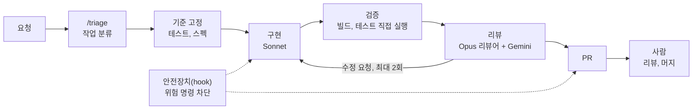

# AI 개발 하네스

Claude Code를 이 MSA 프로젝트의 구현, 버그 수정, 리팩토링에 실제로 쓰기 위해 만든 작업 환경(하네스)입니다. 프롬프트로만 통제하기 어려운 완료 기준, 기존 동작 보존, 실행 권한 경계를 테스트 게이트와 hook, 교차 리뷰 파이프라인으로 묶었습니다.

## 문제

AI 코딩 도구를 별도 장치 없이 그대로 투입하면 이 프로젝트에서 다음 문제가 생깁니다.

- **완료 기준 부재**: 작업이 제대로 끝났는지 판단할 기준이 없어 결국 바뀐 코드를 처음부터 다 읽어야 합니다.
- **테스트 변조로 인한 동작 훼손**: AI가 리팩토링 도중 실패하는 테스트를 구현에 맞춰 고치면, 테스트가 통과하더라도 기존 동작이 바뀐 사실을 놓칩니다.
- **과도한 실행 권한**: 같은 레포에 Terraform, 배포 워크플로우, `.env`, 공유 브랜치가 함께 있어 잘못된 명령 하나가 바로 사고로 이어질 수 있습니다.
- **자기 리뷰의 한계**: 코드를 작성한 모델이 같은 컨텍스트에서 리뷰하면 자기가 범한 실수를 똑같이 놓칩니다.

## 핵심 아이디어

작업을 **완료 기준을 어디서 얻을 수 있는지**에 따라 세 그룹으로 나누고, 그룹별로 AI에 위임하는 범위를 다르게 정했습니다.

| 그룹 | 작업 | 완료 기준 | AI가 맡는 범위 |
|---|---|---|---|
| A | 리팩토링, 버그 수정 | 레포 내부(기존 동작, 기대 동작) | 기준 테스트 작성부터 PR까지 |
| B | 기능 개발, 조사/문서 | 신규 정의 필요 | 스펙 초안 작성, 스펙 승인 후 구현 |
| C | 인프라/배포, 성능 | 실행 환경에서 검증 | 변경 초안, 로컬 검증, 측정까지 |

어느 그룹이든 구현 전에 기준(테스트, 승인된 스펙, 측정 기준선)을 먼저 커밋하고 그 뒤로는 바꾸지 않습니다. 리뷰 단계에서는 먼저 이 기준 테스트가 의도를 담고 있는지, 수정 없이 통과했는지부터 확인합니다.

## 하네스 구성

| 구성 요소 | 하는 일 | 위치 |
|---|---|---|
| 규칙 | 빌드 명령, 계층 규칙, 금지 사항, 문서 작성 규칙을 AI가 작업 시작 시점에 읽습니다 | `CLAUDE.md`(루트, 서비스별, `infra/`) |
| 작업 절차(스킬 11개) | 분류, 버그 수정, 리팩토링, 기능 개발, 인프라 변경, 성능 측정, 문서 교정 절차를 명령 하나로 실행합니다 | `.claude/skills/` |
| 역할별 에이전트(7개) | 탐색은 Haiku, 테스트 작성과 구현은 Sonnet, 리뷰는 Opus가 맡습니다. 리뷰어는 파일 읽기와 읽기 전용 git 명령만 쓸 수 있습니다 | `.claude/agents/` |
| 안전장치(hook) | 머지, 공유 브랜치 push, 시크릿 파일 접근, Terraform 실행 같은 위험한 명령을 실행 직전에 막고, 작업을 끝낼 때 컴파일을 확인합니다. 차단 규칙은 회귀 테스트로 고정했습니다 | `.claude/hooks/` |
| 이종 모델 교차 검증 | Gemini가 코드를 2차 리뷰하고 문서 문장을 교정합니다 | `scripts/ai/code-review.py`, `doc-review.py` |
| 구조 규칙 테스트 | 계층 의존 규칙을 테스트로 검사합니다. 기존 위반 34개 클래스는 동결하고 새 위반만 실패로 처리합니다 | 서비스별 `LayerArchitectureTest` |
| 작업 상태 파일 | 완료 기준, 진행 로그, 리뷰 결과를 파일에 남겨 세션이 끊겨도 이어서 작업할 수 있습니다 | `docs/ai-system/tasks/` |
| GitHub 자동화 | 주간 지표와 개선 후보를 리포트 이슈로 만들고, 이슈에서 `@claude`를 호출하면 분류부터 시작합니다 | `.github/workflows/ai-weekly.yml`, `claude.yml` |

## 주요 설계 결정

세부적인 대안 비교와 선정 이유는 [decisions.md](decisions.md)에 정리했습니다.

- **오케스트레이터의 직접 검증**: 구현 에이전트가 "통과"라고 보고해도, 오케스트레이터(메인 세션)가 빌드와 테스트를 직접 실행해 종료 코드와 테스트 수를 확인합니다. 첫 검증 작업에서 테스트 작성 에이전트가 실행 결과 없이 종료하고, 구현 에이전트가 테스트 수 없이 성공만 보고한 사례를 겪고 정한 원칙입니다.
- **작성자와 리뷰어 분리**: 리뷰어 에이전트는 작성자와 분리된 컨텍스트에서 같거나 더 강한 모델(Opus)로 검토합니다. 이후 이종 모델(Gemini)이 2차 리뷰를 진행해 단일 모델 계열이 공통으로 놓치는 결함을 줄였습니다.
- **되돌리기 어려운 작업의 수동 승인**: 머지, 스펙 승인, Terraform plan과 apply, 배포는 수동 승인으로만 처리합니다. AI에는 클라우드 자격 증명을 주지 않고, hook이 뚫릴 경우에 대비해 GitHub 브랜치 보호를 마지막 경계로 둡니다.
- **기존 부채 동결과 신규 위반 차단**: 계층 규칙 위반 34개 클래스를 한꺼번에 고치는 대신 현재 상태로 동결하고, 신규 위반이 생기면 테스트가 실패하게 했습니다. 하네스를 검증한 뒤 리팩토링 이슈로 하나씩 줄여 나갑니다.
- **비용을 고려한 모델 라우팅과 배치 호출**: 파일을 많이 읽고 짧게 보고하는 탐색은 경량 모델에, 판단이 필요한 리뷰는 고성능 모델에 배정합니다. 호출마다 고정 비용이 큰 Gemini는 변경된 부분만 묶어 한 번에 보냅니다.

## 검증 결과

실제 이슈 작업과 의도적으로 결함을 심은 테스트로 하네스를 점검했습니다. 상세 측정값은 [metrics.md](metrics.md)에 있습니다.

| 점검 | 결과 |
|---|---|
| 버그 수정 1건([이슈 #5](https://github.com/bstaran/CC-Creator-Culture/issues/5), [PR #9](https://github.com/bstaran/CC-Creator-Culture/pull/9), [작업 기록](tasks/5.md)) | 재현 테스트 15개 중 4개가 실패하는 상태를 먼저 커밋하고, 수정 후 15개가 모두 통과했습니다. 추가 수정 없이 그대로 머지했습니다 |
| 리팩토링 1건([이슈 #7](https://github.com/bstaran/CC-Creator-Culture/issues/7), [PR #15](https://github.com/bstaran/CC-Creator-Culture/pull/15)) | 기존 테스트가 다루지 않던 동작을 특성 테스트 5개로 먼저 고정했습니다. 리팩토링 전후 모두 테스트 786개가 통과했고, 구조, 이벤트, Gemini 리뷰에서도 수정 요청이 없었습니다. 현재 리뷰 대기 중입니다 |
| Gemini 코드 리뷰 | 버그 4개를 심은 브랜치에서 4개를 모두 검출했고 오탐은 없었습니다. [PR #12](https://github.com/bstaran/CC-Creator-Culture/pull/12)에서는 Claude 리뷰어가 놓친 실제 버그 2건을 찾았습니다 |
| 문서 교정 비용 | 문서마다 따로 호출하던 방식(18회, 7분 52초)을 변경분만 묶는 방식(3회, 2분 26초)으로 바꿨습니다. 심은 오류 10개는 모두 찾았습니다 |
| 안전장치 | CI 연동 리뷰([PR #14](https://github.com/bstaran/CC-Creator-Culture/pull/14))에서 지적된 push 차단 우회 경로를 막고, 차단 규칙 회귀 테스트를 65개에서 100개로 늘렸습니다 |

점검 과정에서 드러난 하네스 자체의 결함도 함께 고쳤습니다. 포맷 검사 도구가 worktree에서 동작하지 않던 문제는 도구 버전을 올려 해결했고, 구현 에이전트가 테스트 수를 빠뜨리던 문제는 결과 XML 파일 기준으로 수치를 보고하도록 지침을 보강했습니다.

## 한계

- GitHub 쪽 자동화(이슈의 `@claude`, 주간 리포트의 정기 스캔)는 CI 토큰 문제로 아직 실환경에서 돌리지 못했습니다. 현재까지는 로컬 작업 절차만 실제 이슈로 검증했습니다.
- 실제 작업 검증은 그룹 A 2건뿐입니다. 기능 개발(B), 인프라와 성능(C)은 도구와 절차만 구성했고 아직 실전 작업으로 검증하지 못했습니다.
- AI PR 무수정 승인율 같은 장기 지표는 주간 리포트로 쌓아 가는 초기 단계라 아직 추세를 판단할 표본이 부족합니다.
- hook의 명령 문자열 기반 차단은 알려진 우회 형태를 하나씩 막는 방식이라 완전하지 않습니다. 저장소 브랜치 보호를 함께 두는 이유입니다.

## 현재 상태(2026-11-23)

- 하네스 구축을 마치고 실제 이슈에 투입해 검증하는 단계입니다. 남은 점검 대상은 그룹 A 2건([#6](https://github.com/bstaran/CC-Creator-Culture/issues/6), [#8](https://github.com/bstaran/CC-Creator-Culture/issues/8)), 기능 개발 1건, 인프라 변경 1건, 성능 비교 1건입니다.
- 점검이 끝나면 동결한 계층 위반 34개 클래스를 리팩토링 작업으로 줄여 나갈 예정입니다.
- CI 토큰을 복구하면 [playbooks/operations.md](playbooks/operations.md)의 체크리스트 순서대로 GitHub 자동화를 점검합니다.

## 문서 안내

| 독자 | 문서 |
|---|---|
| 처음 보는 분 | 이 문서 → [decisions.md](decisions.md)(설계 결정) → [metrics.md](metrics.md)(측정 기록) |
| 하네스를 쓰는 팀원 | [guide.md](guide.md)(사용 방법) |
| 작업 사례 | [tasks/](tasks/)(작업별 진행 기록), [audits/](audits/)(전체 코드 진단 결과) |
| 구현 상세 | [playbooks/](playbooks/)(트랙별 절차와 운영 절차), [plan.md](plan.md)(초기 설계안) |
