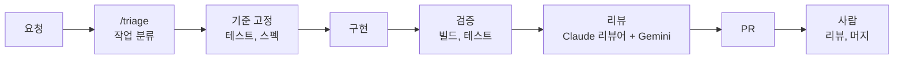

# AI 작업 체계 소개

이 레포에서 AI(Claude Code)로 개발할 때 쓰는 작업 방식과 도구를 설명한다. 사용 방법은 [guide.md](guide.md), 설계 배경과 결정 기록은 [plan.md](plan.md)에 있다.

## 한 줄 요약

AI가 작업을 시작하기 전에 **"무엇이 되면 완료인가"를 테스트나 스펙으로 먼저 고정**하고, 구현, 검증, 리뷰를 거쳐 PR을 연다. 머지, 스펙 승인, 배포처럼 되돌리기 어려운 결정은 항상 사람이 한다.

## 왜 이렇게 하는가

AI에게 "알아서 고쳐 줘"라고 맡기면 결과가 맞는지 판단할 기준이 없어 리뷰가 어렵고, 기존 동작이 사람이 모르는 사이에 바뀌기 쉽다. 그래서 작업을 **완료 기준을 어디서 얻는지**에 따라 세 그룹으로 나누고, 그룹마다 기준을 만드는 방법을 정했다.

| 그룹 | 작업 종류 | 완료 기준 | AI가 하는 범위 |
|---|---|---|---|
| A | 리팩토링, 버그 수정 | 레포 안에 이미 있다(기존 동작, 기대 동작) | 기준 테스트 작성부터 PR까지 |
| B | 기능 개발, 조사/문서 | 새로 만들어야 한다 | 스펙 초안 작성, 사람이 승인한 뒤 구현 |
| C | 인프라/배포, 성능 | 실제 환경에서만 확인된다 | 변경 초안, 로컬 검증, 측정까지(적용과 배포는 사람) |

## 작업은 이렇게 흘러간다

1. **분류**: 모든 요청은 `/triage`로 시작하며, 여기서 작업 종류(트랙)와 완료 기준, 위험 요소를 정한다.
2. **기준 고정**: 리팩토링은 현재 동작을 고정하는 특성 테스트, 버그 수정은 버그 때문에 실패하는 재현 테스트, 기능 개발은 승인된 스펙과 요구사항 테스트를 먼저 커밋한다. 이후 이 테스트는 바꾸지 않는다.
3. **구현과 검증**: 구현을 맡은 AI의 보고를 그대로 믿지 않고, 작업을 지휘하는 AI가 빌드와 테스트를 직접 실행해 통과 여부와 테스트 수를 확인한다.
4. **리뷰**: 구조, 이벤트, 스키마, 인프라 리뷰어(Claude)가 먼저 보고, 다른 모델(Gemini)이 한 번 더 본다. 차단 지적이 있으면 구현으로 돌아가며, 수정 요청은 최대 2회다.
5. **PR**: PR 본문과 문서는 Gemini로 문장을 교정한 뒤 올린다. 머지는 사람이 한다.

작업마다 진행 상황을 `docs/ai-system/tasks/<이슈번호>.md`에 기록하므로, 세션이 끊기거나 다른 사람이 이어받아도 이 파일부터 읽으면 된다.

## 구성 요소

| 구분 | 무엇 | 위치 |
|---|---|---|
| 규칙 | 빌드 명령, 계층 규칙, 금지 사항, 문서 작성 규칙. AI가 작업을 시작할 때 자동으로 읽는다 | `CLAUDE.md`(루트, 서비스별, `infra/`) |
| 스킬 | 작업 종류별 절차를 실행하는 명령(`/triage`, `/bugfix` 등) | `.claude/skills/` |
| 에이전트 | 일을 나눠 맡는 AI. 탐색(Haiku), 테스트 작성과 구현(Sonnet), 리뷰(Opus) | `.claude/agents/` |
| 안전장치(hook) | AI가 하면 안 되는 명령을 실행 직전에 막고, 작업을 끝낼 때 컴파일을 확인한다 | `.claude/hooks/` |
| 다른 모델 교차 확인 | Gemini(Antigravity CLI)로 문서 문장 교정과 코드 2차 리뷰. 로컬에서만 동작한다 | `scripts/ai/doc-review.py`, `code-review.py` |
| 계층 규칙 검사 | `application`이 `presentation`에 의존하는 등 새 위반이 생기면 테스트가 실패한다. 기존 위반 34개 클래스는 동결해 두었다 | 서비스별 `LayerArchitectureTest` |
| 자동화 | 매주 지표와 바뀐 코드 점검 결과를 리포트 이슈로 남기고, 이슈에서 `@claude`를 부르면 분류부터 시작한다 | `.github/workflows/ai-weekly.yml`, `claude.yml` |
| 절차서 | 그룹별 상세 절차와 운영 절차 | `docs/ai-system/playbooks/` |

## 사람과 AI의 역할

| 사람이 한다 | AI가 한다 |
|---|---|
| 작업 시작 지시 | 분류, 기준 테스트, 구현, 검증, 리뷰, PR 작성 |
| 기능 스펙 승인(`spec: approved` 라벨) | 스펙 초안 작성 |
| PR 리뷰와 머지 | 리뷰 지적 반영(최대 2회) |
| Terraform plan, apply, 배포(CI) | 인프라 변경 초안과 로컬 검증, 예상 plan 요약 |
| 주간 리포트에서 등록할 후보 고르기 | 후보 진단, 고른 후보만 이슈 등록 |

## AI가 할 수 없는 일

아래 일은 hook과 CI 설정이 실행 직전에 막는다. 막히면 AI는 우회하지 않고 사유를 보고한다.

- PR 머지와 승인, 스펙 승인 라벨 부착
- `dev`, `main`에 직접 push, 강제 push, 원격 브랜치 삭제, `origin` 외 저장소로 push
- `.env`, Terraform 변수와 상태 파일 같은 비밀 값 읽기
- `terraform plan/apply/destroy`, 배포 워크플로우 실행, 클라우드 자원 변경, 이미지 push
- 기존 DB 마이그레이션 수정, 테스트 건너뛰기(`-x test`)

AI 쪽 차단은 알려진 우회 형태를 하나씩 막는 방식이라 완전하지 않다. 마지막 경계는 GitHub의 `dev`, `main` 브랜치 보호 설정이다.

## 효과는 어떻게 보는가

매주 월요일 주간 리포트 이슈에 지표가 자동으로 쌓이고, 매월 한 번 사람이 리뷰한다. 주로 보는 지표는 다음과 같다.

- **AI PR 무수정 승인율**: AI가 만든 PR(`ai: generated` 라벨)이 사람의 수정 없이 머지된 비율. 작업 종류별로 이 비율이 충분히 높아지면 그 종류의 자동화 범위를 넓힌다.
- **PR 크기와 리드타임**: PR이 작게 유지되는지, 요청부터 머지까지 얼마나 걸리는지
- **동결된 계층 위반 수**: 구조 개선이 실제로 진행되는지

측정값과 검증 기록은 [metrics.md](metrics.md)에 있다.

## 현재 상태(2026-11-20)

- 도구 구축은 끝났고, 실제 작업으로 체계를 점검하는 중이다. 버그 수정 1건(#5, 머지됨)과 리팩토링 1건(#7, PR #15)을 처리했다.
- GitHub 쪽 자동화(주간 리포트의 코드 점검, 이슈의 `@claude`)는 CI 토큰에 문제가 생겨 아직 실제로 실행해 보지 못했다. 토큰을 복구한 뒤 [playbooks/operations.md](playbooks/operations.md)의 확인 표대로 점검한다.
- 남은 일과 결정이 필요한 사항은 [plan.md](plan.md) 14, 15장에 있다.

## 문서 안내

| 알고 싶은 것 | 문서 |
|---|---|
| 어떻게 쓰는가 | [guide.md](guide.md) |
| 그룹별 상세 절차 | [playbooks/group-a.md](playbooks/group-a.md), [group-b.md](playbooks/group-b.md), [group-c.md](playbooks/group-c.md) |
| 주간, 월간 운영 | [playbooks/operations.md](playbooks/operations.md) |
| 설계 배경, 결정 기록, 로드맵 | [plan.md](plan.md) |
| 지표와 검증 기록 | [metrics.md](metrics.md) |
