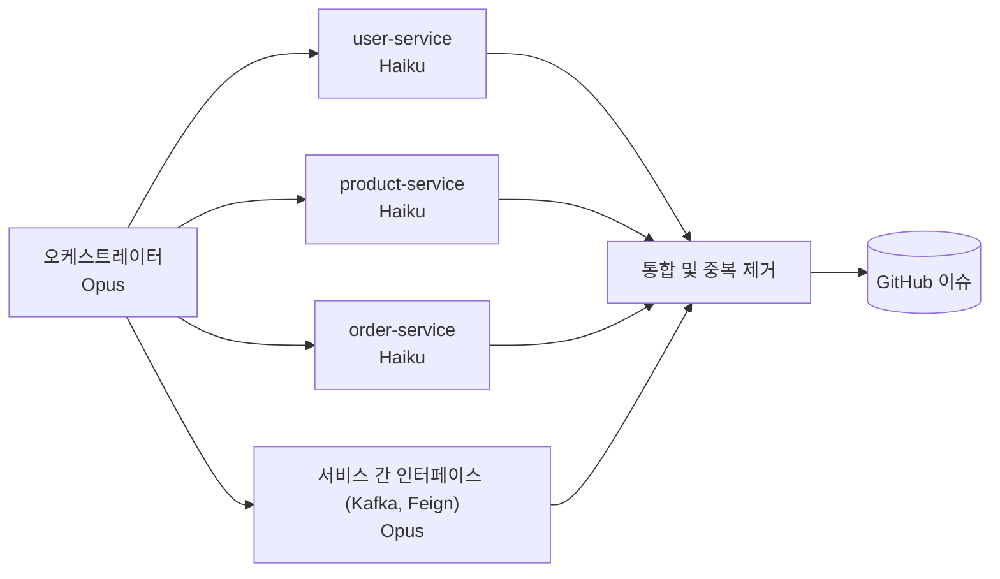
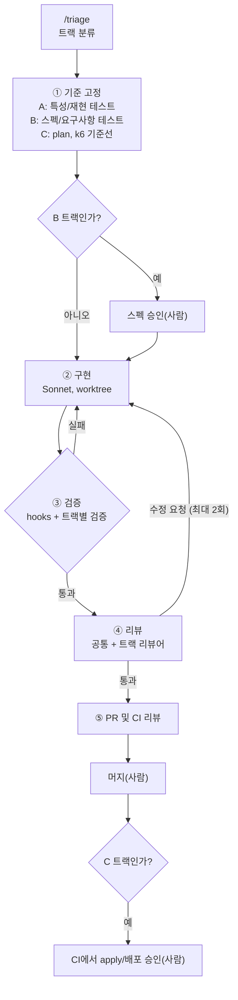
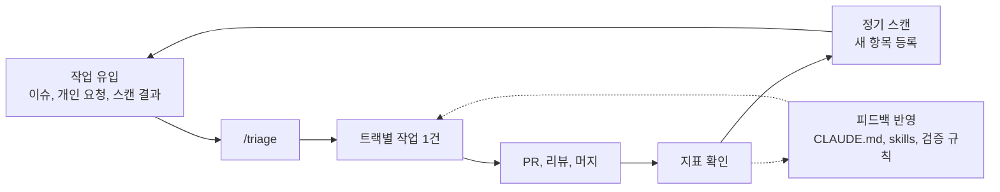

# CC AI 개발 운영 체계

> 상태: 초안(팀 검토 전) | 작성일: 2026-11-18 | 대상: cc-service(Java 21, Spring Boot 4.1 MSA)

## 목차

1. [요약](#1-요약)
2. [범위와 현재 상태](#2-범위와-현재-상태)
3. [성공 기준에 따른 트랙 분류](#3-성공-기준에-따른-트랙-분류)
4. [운영 원칙](#4-운영-원칙)
5. [공통 기반 구조](#5-공통-기반-구조)
6. [AI 운영 계층](#6-ai-운영-계층)
7. [작업 입구와 트랙](#7-작업-입구와-트랙)
8. [그룹별 추가 환경](#8-그룹별-추가-환경)
9. [반복 루프](#9-반복-루프)
10. [로드맵](#10-로드맵)
11. [지표](#11-지표)
12. [리스크와 대응](#12-리스크와-대응)
13. [초기 작업 후보](#13-초기-작업-후보)
14. [결정이 필요한 사항](#14-결정이-필요한-사항)
15. [다음 단계](#15-다음-단계)

---

## 1. 요약

리팩토링, 기능 개발, 버그 수정부터 인프라, 성능, 조사까지 개발 작업 전반을 AI와 함께 처리하는 체계를 만든다. AI는 탐색, 테스트 작성, 구현, 1차 리뷰를 맡고, 기준 승인과 머지는 사람이 맡는다.

- **성공 기준이 어디에 있는지에 따라 작업을 나눈다.** 기준이 레포 안에 있는 작업(A), 기준을 사람이 만들어야 하는 작업(B), 기준을 확인하려면 실행 환경이 필요한 작업(C)은 자동화 방식이 다르다.
- **공통 기반은 하나로 만든다.** 맥락, 검증, 모델 라우팅, 오케스트레이션, 상태 관리, 권한, 리뷰는 모든 트랙이 함께 쓴다.
- **모든 작업은 `/triage`로 들어온다.** 백로그, 이슈, 개인 요청, 정기 스캔 결과를 하나의 입구에서 트랙으로 나눈다.
- **트랙은 기준이 명확한 것부터 도입한다.** A(리팩토링, 버그 수정) → B(기능 개발, 문서) → C(인프라, 성능) 순서다.
- **자동화는 그룹별로 단계적으로 넓힌다.** 처음에는 스캔과 리뷰만 자동으로 돌리고, 작업 실행 시작과 머지는 사람이 맡는다.

## 2. 범위와 현재 상태

### 범위

| 포함 | 제외 |
|---|---|
| 리팩토링, 버그 수정, 기능 개발, 조사/문서, 인프라, CI/CD, 배포 변경, 성능 개선 | 운영 환경 apply와 배포의 자동 실행, 사람의 승인 없는 머지 |

### 현재 상태

| 항목 | 상태 |
|---|---|
| 규모 | 서비스 3개(user, product, order), main 약 650개 파일, test 약 250개 파일, 전체 약 2.7만 줄 |
| 구조 | 서비스마다 domain / application / infrastructure / presentation 계층이 일관됨 |
| AI 관련 | `claude-code-review.yml`(PR 자동 리뷰), `claude.yml`(`@claude` 호출) |
| 실행 및 검증 자산 | compose 전체 스택, Testcontainers, EmbeddedKafka, k6 + Prometheus, Grafana, Terraform, `.github/scripts/*_test`, actionlint |
| 없는 것 | `CLAUDE.md`, 프로젝트 `.claude/`(skills, agents, hooks), ArchUnit, JaCoCo, Spotless, 스키마 테스트, AI용 권한 분리 |

실행 환경은 상당 부분 갖춰져 있다. 부족한 것은 AI가 읽을 맥락, 결과를 기계적으로 판정하는 검증 장치, 그리고 AI가 할 수 있는 일의 경계다.

## 3. 성공 기준에 따른 트랙 분류

안전하게 자동화하려면 결과가 맞는지 기계적으로 판정할 기준이 있어야 한다. 그 기준이 어디에 있는지에 따라 트랙을 세 그룹으로 나눈다.

| 그룹 | 트랙 | 성공 기준이 있는 곳 | 부족한 것 | 필요한 추가 환경 |
|---|---|---|---|---|
| **A** | 리팩토링, 버그 수정 | **레포 안.** 기존 테스트, 재현 테스트가 곧 기준 | 커버리지가 낮은 영역의 안전망 | 없음. 안전망(ArchUnit, 특성 테스트)만 갖추면 됨 |
| **B** | 기능 개발, 조사/문서 | **아직 없음.** 사람이 정해야 생김 | 기준 자체 | 기준을 **만드는** 환경: 스펙 게이트, 스키마 검증, 통합 실행 |
| **C** | 인프라/배포, 성능 | **실행 환경 안.** 기준은 있지만 실행해 봐야 확인됨 | 실행 장소와 권한 | 기준을 **확인하는** 환경: 격리 실행, 관측 접근, 권한 분리, 측정 안정성 |

- **A**는 1단계 안전망이 갖춰지면 리팩토링 기준을 그대로 적용해 자동화할 수 있다. 커버리지가 낮은 영역은 특성 테스트를 먼저 보강해야 "기준이 있다"는 전제가 성립한다.
- **B**는 스펙 게이트를 통과해 요구사항 테스트가 승인되면, 그다음부터는 A와 같은 구조로 자동화할 수 있다. 기준을 확정하기 전에는 사람이 맡고, 확정한 뒤에는 자동화한다.
- **C**는 환경을 갖춰도 **실행과 확인은 자동, 적용은 항상 사람**이다.

## 4. 운영 원칙

### 4.1 공통 원칙

1. **사람이 결정하고 AI가 실행한다.** 우선순위, 기준 승인, 설계 결정, 머지는 사람이 맡는다.
2. **기준을 먼저 고정한다.** 어떤 트랙이든 구현 전에 성공 기준(테스트, 스펙, plan, 기준선)을 만든다.
3. **검증 없이 머지하지 않는다.** 모든 변경은 hooks 검증, 에이전트 리뷰, 사람 승인을 거친다.
4. **작성자와 검토자를 분리한다.** AI가 작성한 코드는 다른 컨텍스트의 에이전트가 검토하고, 마지막에 사람이 승인한다.
5. **PR은 작게, 변경 유형은 분리한다.** 리팩토링, 버그 수정, 기능, 인프라 변경을 한 PR에 섞지 않는다.
6. **작업은 fork 레포에서 진행한다.** 브랜치, PR, CI 모두 fork 기준이다.

### 4.2 그룹별 원칙

| 그룹 | 원칙 |
|---|---|
| **A** | 리팩토링은 특성 테스트를 먼저 커밋하고, 버그 수정은 실패하는 재현 테스트를 먼저 커밋한다. 리팩토링 PR에서 기존 테스트가 바뀌면 사람이 확인한다. |
| **B** | 승인된 스펙과 요구사항 테스트 없이 구현을 시작하지 않는다. 승인된 요구사항 테스트를 바꾸려면 다시 승인을 받는다. |
| **C** | AI는 plan과 측정까지만 수행한다. apply와 배포는 사람이 CI 승인 단계에서 실행한다. 성능은 반복 측정과 허용 오차로 판단한다. |

### 4.3 자동화 범위

> **합의 사항**
> 작업 루프 전체를 자동화할 수도 있다. 하지만 의도대로 동작하는지 판단하는 일이 가장 중요하다. 그래서 처음에는 **스캔과 리뷰만 자동으로 돌리고, 작업 실행 시작과 머지는 사람이 맡는다.** 루프가 안정되면 위험도가 낮은 유형부터 자동 실행 범위를 넓힌다.

| 그룹 | 도입 초기 | 안정된 뒤 자동으로 전환 | 항상 사람이 담당 |
|---|---|---|---|
| **공통** | 정기 스캔, PR 1차 리뷰(처음부터 자동) | - | 우선순위 결정 |
| **A** | 작업 실행은 사람이 시작 | 테스트 보강, 포맷 정리, 단순 중복 제거, 재현 테스트가 있는 단순 버그 수정 | 머지 |
| **B** | 스펙 초안은 AI가 작성, 구현 실행은 사람이 시작 | 스펙 승인 이후 구현 | 스펙 승인, 머지 |
| **C** | plan 생성과 성능 측정은 사람이 시작 | PR별 plan 생성과 성능 비교 | apply, 배포, 머지 |

**확대 기준(제안):** 특정 작업 유형에서 최근 10건의 PR이 수정 요청 없이 승인되었고 회귀가 0건이면, 그 유형은 자동 실행으로 전환한다. 전환하더라도 PR 생성까지만 자동으로 처리하고 머지는 사람이 한다.

## 5. 공통 기반 구조

모든 트랙이 함께 쓰는 다섯 개 계층으로 구성된다.

| 계층 | 역할 | 구성 요소 |
|---|---|---|
| ① 맥락 | AI가 매번 프로젝트를 다시 파악하지 않게 함 | `CLAUDE.md`(루트, 서비스별, infra), `docs/adr/`, `docs/architecture.md` |
| ② 검증 | AI가 결과를 스스로 확인하게 함 | ArchUnit, 특성/재현/요구사항/스키마 테스트, JaCoCo, Spotless, hooks, `scripts/ai/` 실행 스크립트 |
| ③ 실행 | 반복 작업을 절차로 고정함 | `/triage`와 트랙별 skills, worktree |
| ④ AI 운영 | 모델 선택, 작업 지휘, 상태 관리, 권한 제어, 자체 개선을 담당함 | 모델 라우팅, 오케스트레이션, 상태 파일, 에이전트별 권한, 개선 루프 |
| ⑤ 리뷰/운영 | 결과 확인과 반복 루프 유지를 담당함 | CI 리뷰, `/code-review`, `/security-review`, 정기 스캔, 지표 |

### ① 맥락 계층

- **루트 `CLAUDE.md`**: 빌드와 테스트 명령(`./gradlew :apps:order-service:test` 등), 모듈 구조, 계층 의존 규칙, 커밋과 PR 규칙, 트랙 분류 기준, 금지 사항
- **`apps/*/CLAUDE.md`**: 도메인 용어, Kafka 토픽과 이벤트 스키마, Outbox 사용 방식, 주의해야 할 동시성 구간(쿠폰 Redis Lua, 리더보드 ZSET 등)
- **`infra/CLAUDE.md`**: Terraform 구조, plan 실행만 허용하는 규칙, 배포 절차와 사람 승인 지점
- **`docs/adr/`**: 이미 내린 결정을 짧게 기록해 AI가 끝난 논의를 다시 꺼내지 않게 한다.
- CI 리뷰 워크플로우에 하드코딩된 리뷰 기준은 `CLAUDE.md`를 참조하도록 바꿔 규칙을 한 곳에서 관리한다.

### ② 검증 계층

| 도구 | 역할 | 주로 쓰는 그룹 |
|---|---|---|
| ArchUnit | 헥사고날 계층 규칙을 테스트로 고정. 기존 위반은 baseline으로 동결하고 새 위반만 실패 처리 | 전체 |
| 특성 테스트 | 리팩토링 전 현재 동작 고정 | A |
| 재현 테스트 | 버그를 실패하는 테스트로 고정 | A |
| 요구사항 테스트 | 승인된 스펙을 테스트로 고정 | B |
| 스키마 테스트 | API 요청/응답과 Kafka 이벤트 스키마 고정 | B |
| JaCoCo | 커버리지가 낮은 영역 파악 | A |
| Spotless | 포맷 차이로 인한 diff 오염 방지(적용 커밋은 따로 분리) | 전체 |
| hooks | 위험 명령 실행과 비밀 값 파일 접근 차단, 작업 종료 시 변경 모듈의 포맷 검사와 컴파일 | 전체 |
| `scripts/ai/` | 스택 기동과 스모크 테스트, Terraform 로컬 검증, 성능 비교, 문서 교정을 실행해 통과/실패 여부 출력 | 전체 |

### ③ 실행 계층

```text
CLAUDE.md
apps/{user,product,order}-service/CLAUDE.md
infra/CLAUDE.md
.claude/
├── settings.json              # 권한 허용 목록, hooks 등록
├── hooks/                     # 컴파일, 테스트, 차단 스크립트
├── agents/
│   ├── explorer.md            # 공통 | Haiku/low | 읽기 전용
│   ├── implementer.md         # 공통 | Sonnet/medium | worktree 내 쓰기
│   ├── test-writer.md         # 공통 | Sonnet/medium
│   ├── arch-reviewer.md       # 공통 | Opus/high | 읽기 전용
│   ├── event-reviewer.md      # A, B | Opus/high | Kafka, Outbox, 트랜잭션
│   ├── schema-reviewer.md     # B | Opus/high | API, 이벤트 스키마
│   └── infra-reviewer.md      # C | Opus/high | Terraform, CI, 배포
└── skills/
    ├── triage/                # 모든 작업의 입구 | 트랙 분류
    ├── refactor-audit/        # A | 서비스 진단 → 이슈
    ├── refactor-task/         # A | 리팩토링 1건
    ├── characterize/          # A | 동작을 테스트로 고정
    ├── bugfix/                # A | 재현 테스트 → 수정
    ├── spec/                  # B | 기능 요구 → 스펙, 요구사항 테스트 초안
    ├── feature/               # B | 승인된 스펙 → 구현
    ├── infra-change/          # C | 변경 → plan → 리뷰
    └── perf-check/            # C | k6 기준선 비교
.github/ISSUE_TEMPLATE/
├── ai-request.md              # AI 작업 요청 양식
└── spec.md                    # B | 스펙 승인 양식
scripts/ai/                    # 통과/실패 여부를 출력하는 실행 스크립트
├── stack-up.sh / stack-down.sh
├── smoke-gateway.sh
├── tf-plan.sh
└── perf-compare.sh
docs/ai-system/
├── plan.md                    # 이 문서
├── guide.md                   # 팀원 사용 가이드
├── playbooks/<트랙>.md         # 트랙별 상세 절차
├── tasks/<이슈번호>.md          # 작업별 계획, 로그, 결정, 남은 일
└── metrics.md
```

작업 목록은 GitHub 이슈 한 곳에서 관리한다. 기존 `type: bug`, `type: feature` 라벨에 `type: refactor`, `type: infra`, `type: perf`, `type: research`를 추가하고, 개인 요청에는 `source: ad-hoc`을 붙인다.

## 6. AI 운영 계층

GitHub과 CI가 AI의 작업 환경이라면, 이 계층은 AI를 어떻게 운용할지에 대한 설계다. 이 설계가 없으면 모든 작업을 같은 모델과 단일 세션으로 처리하게 된다. 그러면 비용이 낭비되고, 긴 작업에서는 컨텍스트가 오염되며, AI가 자신이 작성한 코드를 스스로 리뷰하게 된다.

### 6.1 모델 라우팅: 모델과 effort를 함께 정하기

| 모델 | ID | 입력 $/1M | 출력 $/1M | 용도 |
|---|---|---:|---:|---|
| Haiku 5.5 | `claude-haiku-5-5` | 0.10 | 0.50 | 탐색, 수집, 요약 |
| Sonnet 5.5 | `claude-sonnet-5-5` | 2.00 | 10.00 | 정형적인 구현, 테스트 작성 |
| Opus 5.5 | `claude-opus-5-5` | 4.00 | 20.00 | 계획, 스펙, 오케스트레이션, 리뷰 |
| Fable 5.2 | `claude-fable-5-2` | 8.00 | 40.00 | 난제에만 사용 |

API 단가 기준이다. 구독으로 사용할 때도 무거운 모델일수록 사용 한도가 빠르게 소모된다.

| 역할 | 모델 / effort | 이유 |
|---|---|---|
| 오케스트레이터, 작업 계획, `/triage` | Opus / high | 전체 판단과 작업 분해를 맡아 품질에 미치는 영향이 가장 크다 |
| 스펙 및 요구사항 테스트 초안 | Opus / high | B 트랙의 기준이 되는 산출물이다 |
| 코드 탐색, 사용처 수집, 요약 | Haiku / low | 많이 읽고 짧게 보고하는 작업이다 |
| 정형적인 구현, 테스트 작성 | Sonnet / medium | 기준이 고정된 뒤의 작업이다 |
| 리뷰어(아키텍처, 이벤트, 스키마, 인프라) | Opus / high | 리뷰어는 작성자와 같거나 더 강한 모델이어야 한다 |
| 서비스 간 설계 변경, 동시성 버그, 위험한 인프라 변경 분석 | Fable / high | 주문 동시성, Outbox, 쿠폰 Lua, 네트워크/권한 변경 같은 난제에만 배정한다 |

> **조정 원칙**
> 여러 모델로 단계를 나누기 전에, 강한 모델의 effort를 낮추는 방법을 먼저 시도한다. 최신 모델은 낮은 effort로도 이전 세대의 높은 effort보다 나은 경우가 많고, 모델을 하나로 유지하면 캐시도 재사용된다. 위 표는 초기 기준이며, 작업 1건당 사용량을 보면서 조정한다.

설정은 에이전트 정의 파일의 frontmatter로 고정한다.

```markdown
---
name: infra-reviewer
description: Terraform plan, CI 워크플로우, 배포 설정 변경을 검토한다
model: opus
effort: high
tools: Read, Grep, Glob
---
(검토 기준, 출력 형식, 판단 근거를 적는 본문)
```

### 6.2 오케스트레이션 패턴

#### ① 팬아웃(진단과 조사)

오케스트레이터가 서비스별 탐색을 병렬로 맡기고, 결과를 합쳐 중복을 제거한다. 리팩토링 진단, 영향 범위 조사, 정기 스캔에 쓴다.



#### ② 공통 파이프라인(작업 1건)

모든 트랙이 같은 뼈대를 쓰고, 기준을 고정하는 첫 단계와 리뷰어, 마지막 적용 단계만 다르다.



#### ③ 에스컬레이션

구현자가 검증에서 2회 실패하면 상위 모델로 넘긴다. 그래도 실패하면 멈추고 사람에게 보고한다. 수정 루프에는 반드시 횟수 상한을 둔다.

### 6.3 설계 원칙

- **서브에이전트는 요약만 반환한다.** 탐색하면서 읽은 파일 내용이 오케스트레이터의 컨텍스트에 쌓이지 않게 한다.
- **읽기는 자유롭게, 쓰기는 worktree로 격리해 병렬로 진행한다.**
- **작은 작업에는 오케스트레이션을 쓰지 않는다.** 파일 몇 개짜리 수정은 단일 세션이 더 빠르고 저렴하다.

### 6.4 상태 관리

진행 상태는 대화가 아니라 파일에 둔다. 오케스트레이터는 시작할 때 `docs/ai-system/tasks/<이슈번호>.md`를 읽고, 단계가 끝날 때마다 계획, 진행 로그, 결정 사항, 남은 일을 갱신한다. 세션이 끊기거나 사람이 이어받아도 작업을 차질 없이 계속할 수 있다.

### 6.5 권한과 안전 경계

| 대상 | 제한 |
|---|---|
| explorer, 모든 리뷰어 | 읽기 전용 도구만 허용 |
| implementer, test-writer | worktree 안에서만 쓰기 허용 |
| C 트랙 에이전트 | Terraform은 plan만, 관측 도구는 조회만 허용. apply/배포 자격 증명은 부여하지 않음 |
| hooks 통제 대상 | `terraform apply`/`destroy`, 클라우드 쓰기 명령, 이미지 push, fork 외 원격 push, `.env`와 시크릿 파일 접근 차단. `**/db/migration/**` 수정은 승인 필요 |

### 6.6 AI 시스템 자체의 개선 루프

- **피드백 수집**: 리뷰에서 반려되거나 수정이 필요했던 사유를 트랙별로 분류하고, 반복되면 에이전트 지침이나 `CLAUDE.md`를 보강한다.
- **기준 과제 세트**: 트랙마다 실제 작업 2~3건을 기준 과제로 정하고, 에이전트 정의를 바꿀 때마다 다시 실행해 결과가 나빠지지 않았는지 확인한다.
- **정기 점검**: `/claude-api prompt-audit`으로 `CLAUDE.md`와 에이전트 정의의 낡거나 충돌하는 지침을 점검한다.
- **비용 추적**: 트랙별로 작업 1건당 사용량을 확인해 모델 배치를 조정한다.

## 7. 작업 입구와 트랙

### 7.1 작업 유입 경로

모든 작업은 아래 경로로 들어와 `/triage`를 거친다.

| 경로 | 사용 시점 | 처리 방식 |
|---|---|---|
| 로컬 세션에서 직접 요청 | 담당자가 바로 처리하고 싶을 때 | `/triage`로 분류한 뒤 그 자리에서 처리하거나 이슈로 등록 |
| GitHub 이슈 + `@claude` | 기록을 남기거나, 다른 사람 또는 AI가 처리해도 될 때 | "AI 작업 요청" 템플릿으로 작성한 뒤 `@claude` 코멘트를 남기면 `claude.yml`이 분류 후 브랜치와 PR을 생성 |
| PR 코멘트 `@claude` | 진행 중인 PR을 수정할 때 | 기존 `claude.yml`을 그대로 사용 |
| 정기 스캔 | 주 1회 자동 | 발견한 항목을 주간 리포트 이슈에 체크 목록으로 올리고, 사람이 체크한 항목만 트랙 라벨과 함께 이슈로 등록 |

`/triage`는 열린 이슈를 먼저 확인해 중복 항목을 합치고 요청을 트랙으로 나눈다. 트랙이 분명하면 해당 skill을 바로 호출해도 된다.

### 7.2 트랙 상세

| 트랙 | 그룹 | 먼저 고정할 것 | 검증 | 추가 리뷰어 | skill |
|---|---|---|---|---|---|
| 리팩토링 | A | 특성 테스트 | 기존 테스트 통과, ArchUnit | arch-reviewer, 필요 시 event-reviewer | `/refactor-task` |
| 버그 수정 | A | 실패하는 재현 테스트 | 재현 테스트 통과 확인, 회귀 없음 | 해당 도메인 리뷰어 | `/bugfix` |
| 기능 개발 | B | 스펙, 요구사항 테스트, API/이벤트 스키마 | 요구사항 테스트, 스키마 테스트, 게이트웨이 스모크 테스트, Flyway 마이그레이션 | arch-reviewer, schema-reviewer, event-reviewer | `/spec` → `/feature` |
| 조사/문서 | B | 질문 범위 | 근거 파일과 줄 번호 확인 | 없음(사람이 내용 확인) | `/triage`에서 바로 처리 |
| 인프라/배포 | C | `terraform plan` 결과, 변경 의도 | actionlint, `.github/scripts/*_test`, plan diff가 변경 의도와 일치하는지 확인 | infra-reviewer, `/security-review` | `/infra-change` |
| 성능 | C | k6 기준선 | 같은 시나리오 반복 측정, 허용 오차 이내 | event-reviewer 또는 arch-reviewer | `/perf-check` |

### 7.3 팀원 사용법

`docs/ai-system/guide.md`에 정리할 내용이다.

- 무엇을 하든 `/triage <요청 내용>`으로 시작하거나, "AI 작업 요청" 이슈를 작성한 뒤 `@claude`를 호출한다.
- 트랙을 알고 있으면 해당 skill(`/bugfix #123` 등)을 바로 사용한다.
- 기능 개발은 `spec` 이슈 양식으로 스펙을 먼저 승인받는다.
- 인프라 apply와 배포는 AI에게 맡기지 않는다. CI의 승인 단계에서 직접 실행한다.
- 머지는 항상 도메인 담당자가 한다.

## 8. 그룹별 추가 환경

그룹 A는 공통 기반과 1단계 안전망만으로 충분하다. B와 C는 아래 환경이 더 필요하다.

### 8.1 그룹 B: 기준을 만드는 환경

여기서 부족한 것은 실행 환경보다 **사람이 승인한 기준**이다.

| 구성 | 내용 |
|---|---|
| 스펙 게이트 | `spec` 이슈 양식(배경, 요구사항, 완료 조건, API/이벤트 변경, DB 변경, 영향 서비스)을 쓴다. AI가 스펙 초안과 실패 상태의 요구사항 테스트 초안을 작성하고, 담당자가 승인하면 그 테스트가 기준이 된다 |
| 스키마 검증 | API 요청/응답과 `libs/common`의 Kafka 이벤트를 테스트로 고정한다. 생산자 측 직렬화와 소비자 측 역직렬화를 함께 확인해 서비스 간 영향을 기계적으로 잡아낸다 |
| 통합 실행 | Testcontainers 통합 테스트와 compose 스택을 쓴다. `smoke-gateway.sh`로 게이트웨이를 거쳐 라우트 등록 여부, 인증 필터, 응답 코드를 확인한다. 게이트웨이 라우트나 `config-repo` 반영 누락이 이 단계에서 걸러진다 |

### 8.2 그룹 C: 기준을 확인하는 환경

기준은 분명하지만 레포 밖에서만 확인할 수 있고, 실행하면 외부에 영향이 생긴다.

| 구성 | 내용 |
|---|---|
| 격리 실행 | 운영과 분리된 Terraform workspace, 임시 dev 환경, 로컬 compose 스택을 쓴다. 사용 후에는 자동으로 종료한다(기존 `aws-power.py` 활용) |
| 관측 접근 | AI가 Prometheus, Grafana, Zipkin을 읽기 전용으로 조회한다. 접근은 스크립트나 읽기 전용 토큰으로 제공한다 |
| 권한 분리 | AI 자격 증명으로는 plan과 조회만 허용한다. apply와 배포 자격 증명은 CI의 environment 승인 절차를 거쳐야만 사용할 수 있게 한다. hooks로 쓰기 명령을 한 번 더 차단한다 |
| 측정 안정성 | 동일한 환경에서 같은 시나리오를 여러 번 실행해 중앙값을 비교하고, 허용 오차를 넘으면 실패로 판정한다(제안: 3회 실행, p95 +10%) |

### 8.3 기존 자산을 AI용으로 다듬기

새로 만들기보다 이미 있는 것을 AI가 쓸 수 있게 다듬는 작업이 중심이다.

| 자산 | 현재 상태 | 개선 내용 |
|---|---|---|
| `compose.yaml`, `compose.apps.yaml` | 전체 스택 로컬 실행 | 한 명령으로 기동, 헬스체크, 종료를 수행하고 결과를 통과/실패로 출력(`stack-up.sh`) |
| Testcontainers, EmbeddedKafka | 서비스별 통합 테스트 | 스키마 테스트 추가, 모듈별 실행 명령을 `CLAUDE.md`에 기록 |
| `load-test/`(k6), Prometheus, Grafana | 수동 실행과 시각화 | 기준선 저장, 전후 비교와 허용 오차 판정(`perf-compare.sh`) |
| `infra/terraform`, `aws-deploy.yml` | 수동 plan과 배포 | AI는 plan만 실행하고 요약하며(`tf-plan.sh`), apply는 CI 승인을 거치도록 분리 |
| `.github/scripts/*_test`, actionlint | CI 스크립트 테스트 | `/infra-change` 검증 단계에 연결 |
| `deploy-dev.yml` | 수동 dev 배포 | 사람이 트리거하는 방식 유지 |

## 9. 반복 루프

로드맵의 구축 단계(0~4)는 초기 1회만 진행한다. 트랙이 도입되면 해당 트랙의 작업 루프는 그때부터 계속 순환한다.



| 루프 | 주기 | 내용 |
|---|---|---|
| 작은 루프 | 하루 여러 번 | 이슈나 개인 요청 1건을 트랙 파이프라인으로 처리한다 |
| 큰 루프 | 주 1회 | 정기 스캔 후보 중 사람이 고른 항목을 등록하고, 지표를 보며 우선순위와 자동화 범위를 다시 정한다. 반복되는 지적은 `CLAUDE.md`나 검증 규칙에 반영해 재발을 막는다 |

## 10. 로드맵

트랙은 성공 기준이 명확한 그룹부터 도입한다. 기간은 추정치다.

| 단계 | 기간 | 내용 | 완료 기준 | 사용 가능한 트랙 |
|---|---|---|---|---|
| **0. 공통 기반** | 1~2일 | `CLAUDE.md`(루트, 서비스 3개, infra), `.claude/settings.json`, hooks(검증과 차단), 공통 에이전트 4개, `/triage`, 상태 파일 양식, AI 작업 요청 이슈 템플릿, 트랙 라벨, 팀원 가이드 초안 | 새 세션의 AI가 빌드/테스트 명령과 계층 규칙을 묻지 않고 작업하며, 요청을 트랙으로 분류한다 | 조사(읽기 전용) |
| **1. 안전망** | 3~5일 | ArchUnit(기존 위반은 baseline 동결), JaCoCo, Spotless, 커버리지가 낮은 영역 목록화 | CI 검증을 통과하고, 위반 수와 서비스별 커버리지 기준선이 `metrics.md`에 기록된다 | - |
| **2. 그룹 A 도입** | 1주 | 팬아웃 방식의 리팩토링 진단과 이슈 등록, `/refactor-task`, `/characterize`, `/bugfix`, event-reviewer | 리팩토링과 버그 수정을 각 2건 이상 파이프라인으로 처리한다 | 리팩토링, 버그 수정 |
| **3. 그룹 B 도입** | 1~2주 | `spec` 이슈 양식, `/spec`, `/feature`, 스키마 테스트 기반, `stack-up.sh`, `smoke-gateway.sh`, schema-reviewer | 기능 1건을 스펙 승인부터 머지까지 파이프라인으로 처리한다 | 기능 개발, 문서 |
| **4. 그룹 C 도입** | 1~2주 | AI용 plan/조회 자격 증명과 CI 승인 환경, hooks 차단 확장, `tf-plan.sh`, `perf-compare.sh`, 관측 도구 읽기 접근, k6 기준선, infra-reviewer | 인프라 변경 plan 리뷰 1건과 성능 비교 1건을 처리하고, AI 권한으로는 apply가 불가능함을 확인한다 | 인프라/배포, 성능 |
| **5. 운영** | 지속 | 주간 스캔, 지표 리뷰, 피드백 반영, 기준 과제 회귀 확인, 모델 배치 조정, 그룹별 자동화 확대 판단 | 주간 스캔이 정상 동작하고, 매월 지표를 리뷰한다 | - |

### 진행 현황(2026-11-20)

계획을 바꿔, **모든 그룹의 도구를 먼저 구축한 뒤 트랙별로 일괄 검증**한다. 단계마다 검증을 끼워 넣으면 공통 절차가 바뀔 때마다 앞선 검증을 다시 해야 하기 때문이다. 그룹 A만 공통 뼈대 확인을 위해 1건(#5)을 먼저 검증했다.

| 단계 | 구축 | 검증 |
|---|---|---|
| 0. 공통 기반 | 완료 | 완료 |
| 1. 안전망 | 완료(ArchUnit 동결, JaCoCo, Spotless 기본 규칙) | 완료(CI 통과) |
| 2. 그룹 A | 완료(`/refactor-task`, `/bugfix`, `/characterize`, `/refactor-audit`, event-reviewer) | 1건 완료(#5, PR #9). 남은 검증: #6, #7, #8 |
| 3. 그룹 B | 완료(`/spec`, `/feature`, schema-reviewer, 이벤트 스키마 스냅샷, `stack-up.sh`, `smoke-gateway.sh`) | 대기 |
| 4. 그룹 C | 완료(`/infra-change`, `/perf-check`, infra-reviewer, `tf-check.sh`, `perf-compare.py`, hooks 차단 확장) | 대기 |
| 공통 | `/doc-review`(다른 모델로 문서 문장 교정, PR 전 교정 확인) | 완료(PR #10 문서로 실제 실행, 묶음 방식으로 재설계) |
| 5. 운영 | 완료(주간 리포트 워크플로우 `ai-weekly.yml`, `weekly-metrics.py`, `/refactor-audit` 주간 모드, 운영 절차 `playbooks/operations.md`) | 지표 수집은 로컬에서 확인. 정기 스캔은 CI 토큰 복구 후 첫 실행으로 확인 |
| CI 연동 | 미착수(`claude.yml`에서 `/triage` 시작) | CI 토큰 복구 후 |

4단계 원안의 "AI용 plan/조회 자격 증명"은 두지 않는다. AI는 클라우드 자격 증명 없이 로컬 검증(`tf-check.sh`)과 예상 plan 요약까지 하고, plan은 사람이 CI에서 실행한다. 관측 도구 읽기 접근은 운영 단계에서 다시 검토한다.

## 11. 지표

1단계에서 기준선을 측정했다. 이후에는 매주 주간 리포트 이슈(`ai-weekly.yml`)에 자동으로 기록하고, 매월 리뷰 결과를 `docs/ai-system/metrics.md`에 남긴다(절차: `playbooks/operations.md`).

| 구분 | 지표 | 측정 목적 |
|---|---|---|
| 공통 | AI PR 무수정 승인율(트랙별) | 자동화 범위 확대 여부 판단 |
| 공통 | PR 변경 줄 수(중앙값) | PR 크기가 작게 유지되는지 확인 |
| 공통 | 작업 1건당 사용량(트랙별) | 모델 배치와 effort 조정의 근거 확보 |
| 공통 | 트랙별 작업 수, 개인 요청 비율 | 작업 구성의 균형 확인 |
| A | ArchUnit 위반 수, 서비스별 커버리지 | 구조 개선 현황과 안전망 수준 파악 |
| A | 회귀 발생 건수, 버그 재발률 | 기존 동작 보존과 수정 품질 확인 |
| B | 스펙 승인까지 걸린 시간, 승인 후 스펙 변경 횟수 | 스펙 게이트의 병목 여부와 스펙 품질 확인 |
| B | 기능 리드타임(스펙 승인부터 머지까지) | 구현 자동화의 효과 측정 |
| C | plan과 실제 변경의 불일치 건수 | 인프라 변경 검증의 신뢰도 확인 |
| C | 기준선 대비 성능 변화, 측정 편차 | 성능 판정의 신뢰도 확인 |

## 12. 리스크와 대응

| 그룹 | 리스크 | 대응 |
|---|---|---|
| 공통 | 사용량 급증 | 모델 라우팅, CI 자동 실행 시점 제한, 트랙별 사용량 추적으로 관리한다 |
| 공통 | 긴 세션에서 품질 저하 | 서브에이전트는 요약만 반환하고, 진행 상태는 파일에 둔다 |
| 공통 | 수정 루프가 끝나지 않음 | 수정은 최대 2회로 제한하고, 이후 상위 모델로 넘긴 뒤에도 실패하면 사람에게 보고한다 |
| 공통 | 팀원 간 작업 충돌 | 이슈마다 담당자를 지정하고, worktree로 격리하며, 도메인 담당자가 리뷰한다 |
| 공통 | 시크릿 노출, 잘못된 원격으로 push | hooks로 `.env` 접근과 fork 외 원격 push를 차단한다 |
| A | 리팩토링 중 동작이 바뀜 | 특성 테스트를 먼저 커밋하고, 동작 변경은 별도 PR로 분리한다 |
| A | AI가 테스트를 구현에 맞춰 고쳐 검증이 무력화됨 | 기존 테스트가 바뀌면 리뷰어가 별도로 표시하고 사람이 확인한다 |
| B | 스펙이 모호해 구현이 엇나감 | 완료 조건이 없는 스펙은 승인하지 않는다 |
| B | 구현 중 승인된 요구사항 테스트를 수정함 | 승인된 테스트를 수정할 때는 재승인을 받는다 |
| C | AI가 실수로 apply하거나 배포함 | AI에게 쓰기 자격 증명을 부여하지 않고, hooks와 CI 승인으로 한 번 더 차단한다 |
| C | 성능 측정 노이즈로 잘못 판정함 | 동일한 환경에서 같은 시나리오를 반복 측정하고 허용 오차로 판정한다 |
| C | 격리 환경 비용 | 사용 후 자동 종료하고, 사용 시간을 지표로 추적한다 |

## 13. 초기 작업 후보

이미 확인된 항목이다. 2단계 진단 결과와 종합해 우선순위를 확정한다.

| 항목 | 근거 | 트랙 |
|---|---|---|
| `PATCH /api/v1/admin/products/{id}/status`에 해당하는 게이트웨이 라우트가 없음 | `gateway-local/dev/prod.yaml` 모두 누락(`docs/architecture.md`) | 버그 수정(3단계 이후 게이트웨이 스모크 테스트로 재발 방지) |
| `/api/v1/images` 라우팅이 환경마다 다름 | local은 user-service, dev와 prod는 product-service | 버그 수정(설정) |
| `OrderCreationService` 책임 분리 검토 | 281줄, 주문 생성 핵심 경로 | 리팩토링(특성 테스트 선행) |
| QueryDSL 조회 구현 정리 | `ProductQueryRepositoryImpl` 264줄, `CategoryQueryRepositoryImpl` 177줄 | 리팩토링(N+1 확인 시 성능 트랙으로 측정) |
| 공통 예외 처리 정리 | `libs/common`의 `GlobalExceptionHandler` 200줄 | 리팩토링(전 서비스 영향) |

## 14. 결정이 필요한 사항

- **사용량 예산**: 주 단위 사용량 한도, Fable 사용 승인 기준, 개인 요청을 같은 예산에 포함할지 여부
- **승인 담당**: 도메인별 머지 승인자와 B 트랙 스펙 승인자 지정(README의 도메인 담당자를 그대로 쓸지 여부)
- **자동화 확대 기준**: 제안한 "유형별 최근 10건 무수정 승인, 회귀 0건" 기준을 채택할지 여부
- ~~**ArchUnit 기존 위반 처리**~~ **결정(2026-11-18)**: 기존 위반은 baseline으로 동결하고, AI 작업 체계가 완성된 뒤 리팩토링 트랙으로 개선한다.
- **CI 리뷰 모델**: 자동 리뷰는 Sonnet으로 하고, `@claude`로 요청할 때만 Opus를 쓸지 여부
- ~~**스키마 테스트 방식**~~ **결정(2026-11-19)**: 이벤트 직렬화 구조 스냅샷 테스트(`EventSchemaSnapshotTest`)로 시작한다. API 스키마는 컨트롤러 테스트로 고정한다.
- ~~**C 트랙 격리 환경**~~ **결정(2026-11-19)**: 로컬 compose만 쓴다. AI에게는 클라우드 자격 증명을 주지 않고, plan은 사람이 CI에서 실행한다.
- ~~**문서 교정 방식**~~ **결정(2026-11-19)**: 사람이 읽는 문서의 바뀐 부분만 묶어서 PR 직전에 한 번 `gemini-4-neon-high`로 교정한다. hydrogen은 명백한 오류만 잡고 서술어 누락, 의미 중복 같은 문제를 놓쳐서 쓰지 않는다. `agy`는 호출마다 고정 비용이 커서 호출 횟수를 줄이는 쪽으로 설계했다.
- ~~**정기 스캔 방식**~~ **결정(2026-11-20)**: GitHub Actions(`ai-weekly.yml`)에서 매주 지난 7일 동안 바뀐 소스 파일만 진단한다. 후보는 이슈로 바로 등록하지 않고 주간 리포트 이슈의 체크 목록으로 올린다. 사람이 체크한 항목만 등록한다. 지표 수집은 Claude 없이 스크립트로 하고, 커버리지는 월간 리뷰 때 로컬에서 측정한다.
- ~~**성능 판정 기준**~~ **결정(2026-11-19)**: 3회 실행의 중앙값을 기준으로 p95 +10% 또는 실패율 +1%p를 넘으면 실패로 판정한다(`perf-compare.py` 기본값).

## 15. 다음 단계

1. CI 연동: 이슈의 `@claude` 호출이 `/triage`부터 시작하도록 `claude.yml`을 수정하고, 주간 리포트의 등록 요청을 처리할 수 있게 도구 권한을 맞춘다(CI 토큰 복구 후 `ai-weekly.yml`과 함께 확인).
2. 일괄 검증: 그룹 A(#6, #7, #8), 그룹 B(기능 1건), 그룹 C(인프라 변경 1건, 성능 비교 1건). 검증에서 나온 결함은 skill, 에이전트 지침, hooks를 보완해 해결하고 `metrics.md`에 기록한다.
3. 검증이 끝나면 동결해 둔 계층 위반(34개 클래스)을 리팩토링 트랙으로 개선한다.

---

이 문서는 초안이며, 14장의 결정 사항이 확정되면 갱신한다.
