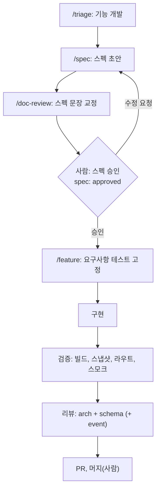

# 그룹 B 파이프라인(기능 개발)

`/spec`과 `/feature`가 따르는 절차다. 그룹 A와 다른 점은 **기준이 아직 없다**는 것이다. 그래서 사람이 승인한 스펙이 기준이 되고, 그 스펙을 테스트로 옮긴 요구사항 테스트가 구현의 성공 기준이 된다.
worktree, 상태 파일, 검증, 리뷰 횟수, PR 규칙은 [group-a.md](group-a.md)와 같고, 아래는 다른 부분만 적는다.

## 전체 흐름



## 1. 스펙(`/spec`)

- 결과물은 `spec` 이슈(`.github/ISSUE_TEMPLATE/spec.md` 구조)다. 기존 이슈가 있으면 본문을 스펙 구조로 갱신하는 안을 코멘트로 제안한다.
- **완료 조건**은 테스트로 확인할 수 있는 문장으로 쓴다("~하면 ~한다"). 모호한 요구(예: "빠르게", "적절히")는 수치나 예시로 바꾸거나 질문으로 남긴다.
- API, 이벤트, DB 변경은 표로 구체적으로 적는다. 기존 계약을 깨는 변경이 필요하면 그 사실과 대안(필드 추가, 버전 분리)을 함께 적는다.
- 스펙 초안의 문장은 `/doc-review`로 다듬는다(중요 문서이므로 `--model gemini-4-neon-high` 권장).
- **AI는 승인하지 않는다.** `spec: approved` 라벨은 사람이 붙인다.

## 2. 기준 고정(`/feature` 시작)

| 기준 | 내용 | 확인 |
|---|---|---|
| 요구사항 테스트 | 완료 조건 AC마다 테스트 1개 이상. 테스트 `@DisplayName`에 AC 번호를 적는다(예: `"AC1: ..."`) | 구현 전이므로 실패하거나 컴파일되지 않는다. 그 상태를 상태 파일에 기록 |
| 이벤트 스키마 | 이벤트가 바뀌면 `EventSchemaSnapshotTest`의 샘플과 스냅샷을 스펙대로 먼저 갱신 | 스냅샷 diff가 스펙의 이벤트 변경과 일치 |
| 게이트웨이 라우트 | 새 외부 경로가 있으면 `GatewayRouteConfigTest`에 케이스 추가 | 라우트 설정 전이면 실패 |

기준이 고정되면 테스트만 먼저 커밋한다: `test(<scope>): #<번호> 요구사항 테스트`. 이후 기준 테스트는 바꾸지 않는다. 스펙이 바뀌어야 하면 멈추고 사람에게 스펙 재승인을 요청한다.

## 3. 구현

`implementer`에게 스펙(완료 조건, API/이벤트/DB 표), 기준 테스트 이름, worktree 경로를 넘긴다. 여러 서비스가 걸리면 서비스별로 나눠 순서대로 맡긴다(생산자 → 소비자, 제공자 → 호출자).

## 4. 검증

그룹 A 검증에 더해 다음을 실행한다.

```bash
./gradlew :libs:common:test --tests '*EventSchemaSnapshotTest'     # 이벤트가 바뀐 경우
./gradlew :infra:gateway:test --tests '*GatewayRouteConfigTest'    # 외부 경로가 바뀐 경우
scripts/ai/stack-up.sh && scripts/ai/smoke-gateway.sh; scripts/ai/stack-down.sh   # 여러 서비스가 걸리거나 라우트, 인증이 바뀐 경우
```

- 스택 스모크 테스트는 Docker와 레포 루트 `.env`가 있어야 한다. 쓸 수 없으면 건너뛰고 PR에 적는다.
- 완료 조건 AC마다 통과한 테스트 이름을 상태 파일에 대응표로 적는다.

## 5. 리뷰

- 항상 `arch-reviewer`와 `schema-reviewer`에게 병렬로 리뷰를 맡긴다. 이벤트, outbox, Lua, `/internal`이 걸리면 `event-reviewer`도 포함한다.
- 리뷰어에게 스펙(이슈 본문)을 함께 넘긴다.
- 수정 요청은 최대 2회까지이며, 그 뒤에는 멈추고 보고한다(그룹 A와 같다).

## 6. PR

- 제목은 `feat(<scope>): <요약>`으로 하고, 본문에 AC 대응표(AC, 테스트, 결과)를 넣는다.
- PR 전에 `/doc-review`로 PR 본문과 바뀐 문서를 다듬는다.
- 배포 시 확인사항(마이그레이션 순서, 이벤트 생산자/소비자 배포 순서)을 반드시 채운다.
