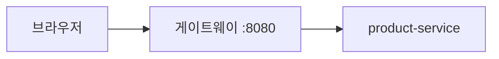
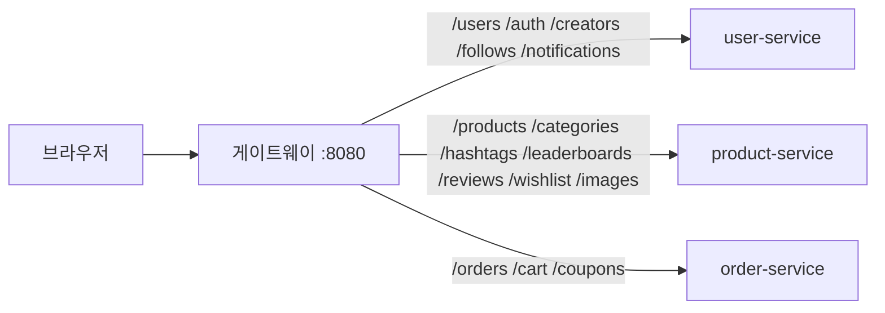
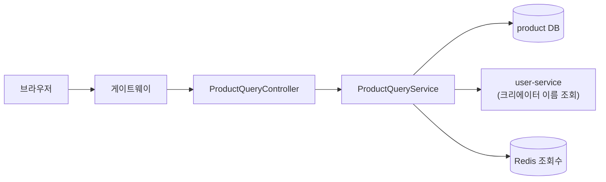
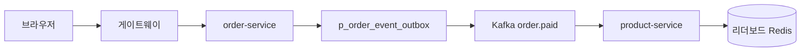

# 프로젝트 구조

CC-Creator-Culture는 크리에이터가 상품을 등록하고 구매자가 주문하는 크리에이터 커머스다. 리더보드는 카테고리와 해시태그 점수로 순위를 매긴다.

스프링 부트 앱은 다음 세 개로 구성된다.

- **`user-service`**: 계정, 로그인, 크리에이터 승인, 팔로우, 알림
- **`product-service`**: 상품, 카테고리, 해시태그, 리더보드, 위시리스트, 리뷰
- **`order-service`**: 장바구니, 주문, 결제, 쿠폰

브라우저의 API 요청은 게이트웨이로 들어온다. 로컬 환경에서 호스트에 열린 포트는 `127.0.0.1:8080` 하나다.

## 요청이 들어오는 경로

상품 상세 조회 요청이 게이트웨이로 들어오면, 게이트웨이는 유레카에서 `product-service` 인스턴스를 찾아 동일한 경로로 요청을 전달한다.

설정 파일은 `config-repo`에 있으며, 컨피그 서버가 이를 읽어 각 앱에 전달한다. `docker/Dockerfile.local`이 `config-repo`를 이미지의 `/config-repo`로 복사하기 때문에, 호스트에서 파일을 고치더라도 이미지를 다시 빌드하기 전에는 실행 중인 서버가 변경된 파일을 읽지 않는다.

컴포즈는 게이트웨이의 스프링 프로필을 `dev`로 둔다. 따라서 게이트웨이가 읽는 라우트 파일은 `config-repo/gateway-dev.yaml`이다.

## 경로 기반 서비스 라우팅

게이트웨이는 요청 경로의 접두어를 기준으로 앱을 선택한다.

| 앱 | 경로 |
|---|---|
| `user-service` | `/api/v1/users`, `/api/v1/auth`, `/api/v1/creators`, `/api/v1/follows`, `/api/v1/admin/managers`, `/api/v1/admin/creators`, `/api/v1/notifications` |
| `product-service` | `/api/v1/products`, `/api/v1/categories`, `/api/v1/hashtags`, `/api/v1/leaderboards`, `/api/v1/admin/categories`, `/api/v1/admin/hashtags`, `/api/v1/wishlist`, `/api/v1/skus`, `/api/v1/admin/leaderboards`, `/api/v1/reviews`, `/api/v1/images` |
| `order-service` | `/api/v1/orders`, `/api/v1/creator/order-items`, `/api/v1/admin/orders`, `/api/v1/cart`, `/api/v1/coupons`, `/api/v1/user-coupons` |

- 앱 사이의 호출은 Feign이나 Kafka로 이루어지며, 게이트웨이 라우트 표에 `/internal/v1`은 없다.
- `/api/v1/images`는 `gateway-local.yaml`에서 `user-service`로, `gateway-dev.yaml`과 `gateway-prod.yaml`에서는 `product-service`로 보낸다. 이 컴포즈 스택의 프로필은 `dev`이므로 이미지 업로드는 `product-service`로 간다.
- `ProductAdminCommandController`에 `PATCH /api/v1/admin/products/{productId}/status`가 있으나, `gateway-local.yaml`, `gateway-dev.yaml`, `gateway-prod.yaml` 모두에 이 경로가 없다(`/api/v1/products/**`는 `/api/v1/admin/products/**`와 일치하지 않는다).

## 게이트웨이 인증

`Authorization` 헤더에 Bearer 토큰이 있으면 `GatewayAuthenticationFilter`가 라우팅보다 먼저 실행된다.

1. 클라이언트가 보낸 `X-User-Id`, `X-User-Role`, `X-Token-Id`, `X-Token-Expires-At` 헤더를 먼저 제거한다.
2. Bearer 액세스 토큰을 검사한다(서명: HS256, 클레임 `type`: `ACCESS`).
3. Redis에 `auth:blacklist:access:{jti}`가 있으면 게이트웨이는 401을 반환하고, Redis 조회가 실패하면 503을 반환한다.
4. 토큰의 사용자 ID, 역할, 토큰 ID, 만료 시각을 위 네 헤더에 넣는다. `Authorization` 헤더는 그대로 둔다.

`GET /api/v1/products/{productId}` 요청에 `Authorization`이 없으면 필터는 JWT 검사를 건너뛴다. 반면 같은 조회에 잘못된 Bearer 토큰이 있으면 게이트웨이는 401을 반환한다.

로그아웃하면 `user-service`의 `logout.lua`가 리프레시 토큰을 삭제하고 `auth:blacklist:access:{tokenId}`를 기록한다. 게이트웨이는 이 키의 존재 여부만 조회한다.

액세스 토큰 검사는 게이트웨이가 맡고 역할 인가는 각 앱이 처리한다(PR #133에 기록됨). 게이트웨이는 `libs/common`을 의존하지 않는데, PR #133은 게이트웨이가 WebFlux이고 `libs/common`이 MVC라는 점을 그 이유로 적고 있다.

## 서비스 내부 구조

각 기능 패키지 아래에는 `domain`, `application`, `infrastructure`, `presentation` 디렉터리가 있다. 패키지 구성과 의존 방식의 특징은 아래와 같다.

- `notification` 컨트롤러의 경로는 `notification/infrastructure/presentation`이다.
- 상품 상세, 장바구니, 리뷰, 위시리스트 컨트롤러는 인바운드 포트에 의존한다.
- 인증, 크리에이터, 팔로우, 사용자, 리더보드, 쿠폰, 주문, 결제 컨트롤러는 `@Service` 클래스를 직접 주입받는다.
- `domain` 패키지의 클래스 대부분은 JPA 엔티티다.

`GET /api/v1/products/{productId}`의 호출 순서는 아래와 같다.

1. `ProductQueryController`가 로그인 사용자, `visitor_cookie`, 경로의 상품 ID를 읽는다.
2. 로그인 사용자이면 `VisitorCookieResolver`가 `user:`와 계정 ID를 반환하고, 아니면 `guest:` 쿠키를 유지하거나 새로 만든다.
3. `ProductQueryService.getProductDetail`이 읽기 전용 트랜잭션에서 `ProductQueryRepositoryImpl`을 호출한다. 쿼리는 `deletedAt`이 `null`인 행만 선택하며, 판매 중지 상태인 상품도 결과에 포함된다.
4. `category` 패키지에 있는 `ProductMetadataQueryAdapter`가 카테고리와 해시태그를 채운다.
5. `ProductUserFeignAdapter`가 `user-service`의 `POST /internal/v1/creators/names`를 호출한다. 서킷 브레이커가 열리면 어댑터는 빈 맵을 반환해 응답의 크리에이터 이름은 `null`로 남지만, 상품 조회 자체는 계속된다.
6. `ProductViewedEvent` 리스너가 HTTP 응답 전에 같은 스레드에서 Redis 조회수를 증가시킨다. Redis가 `DataAccessException`을 던지면 리스너는 로그를 남기고 예외를 삼킨다. 이 요청의 호출 경로에서는 `ProductViewSyncEvent`를 발행하지 않으며, 해당 발행은 `ProductViewCountPublishService`가 맡는다.
7. `ProductDetailResponse`가 이미지 키를 공개 URL로 바꾸고, 컨트롤러가 그 객체를 `ApiResponse`로 감싸 반환한다.

`libs/common`에는 다음 요소가 포함되어 있다.

- 응답 타입: `ApiResponse`, `ErrorResponse`, `PageResponse`
- 예외 처리: `BusinessException`, `GlobalExceptionHandler`
- 역할 어노테이션: `@Creator`, `@Customer`, `@Manager`, `@Master`
- 유틸리티: `UuidV7Generator`
- 메시징: 카프카 이벤트 레코드와 `KafkaTopics`

이 모듈에 의존하는 Gradle 프로젝트는 `user-service`, `product-service`, `order-service`이며, 애그리게이트와 Feign 클라이언트는 이 모듈에 없다.

## 데이터는 어디에 있나

세 앱은 서로의 테이블을 읽지 않으며, 앱마다 별도의 데이터베이스를 사용한다.

- 로컬 `compose.yaml`은 Postgres 서버 하나에 `user_db`, `product_db`, `order_db`를 만든다. 반면 `deploy/compose.dev.yml`은 Postgres 서버를 세 개 띄우고, 운영 설정은 호스트를 `USER_DB_HOST`, `PRODUCT_DB_HOST`, `ORDER_DB_HOST`로 나눈다.
- Flyway SQL은 각 앱의 `src/main/resources/db/migration`에 있다.
- 주문 테이블의 `user_id`에는 `user-service` 테이블을 가리키는 외래 키가 없다. PR #75는 `user_id`가 `user-service` DB의 식별자라서 물리 외래 키를 넣지 않았다고 설명한다.

Redis는 단일 프로세스로 실행된다. 서비스 설정에 별도 Redis DB 인덱스가 없어 앱들이 기본 DB 0을 같이 쓰면서 키 접두어로 데이터를 구분하는 것으로 보인다.

| 사용처 | 키 |
|---|---|
| 게이트웨이, `user-service` | `auth:blacklist:access:{tokenId}`, `auth:refresh:{userId}` |
| `product-service` 리더보드 | `leaderboard:current:category`, `leaderboard:current:hashtag`, `leaderboard:processed:...` |
| `product-service` 조회수 | `product:view:counts`, `product:viewer:{productId}:{viewerId}` |
| `order-service` 쿠폰 | `coupon:{couponId}:remaining`, `coupon:{couponId}:issued:{userId}` |

블랙리스트 접두어는 `libs/common`에 정의되어 있지 않고, 게이트웨이와 `user-service`가 같은 문자열을 각자 갖고 있다.

카테고리 임베딩은 `product-service`가 파이썬 프로세스인 `apps/embedding-service`의 `POST /embed`를 호출해 계산한다. 이 앱은 `settings.gradle`과 README의 모듈 트리에 포함되어 있지 않다.

## 결제에서 리더보드까지

주문 생성 시 재고 차감은 Feign으로 처리한다. `order-service`가 `product-service`의 `POST /internal/v1/stocks/deduct`를 호출하며, 재고 복구 경로는 `POST /internal/v1/stocks/restore`다. 한편 `stock.restore` 토픽의 리스너는 있지만, 이 토픽을 발행하는 코드는 저장소에 없다.

리더보드 점수 변경은 결제 성공 뒤에 발행되는 Kafka 이벤트로 이루어진다.

1. 결제 결과가 `SUCCESS`이면 `PaymentController`가 `MockPaymentService.process`를 호출한다(트랜잭션 전파 옵션: `Propagation.NEVER`).
2. `OrderPaymentResultService.markPaid`가 주문을 결제 완료로 바꾸고, 같은 트랜잭션에서 `p_order_event_outbox`에 행 두 개를 넣는다. 첫 번째 행의 토픽은 `order.paid`이고 페이로드는 `OrderPaidEvent`(주문 ID와 상품별 수량)이며, 두 번째 행의 토픽은 `order.notification`이다.
3. `OrderEventOutboxRelay`가 커밋된 행을 `FOR UPDATE SKIP LOCKED`로 잠근 뒤 가져온다. Kafka가 레코드를 수락한 뒤에 행을 삭제하므로, 삭제에 실패하면 같은 이벤트가 다시 발행될 수 있다.
4. `OrderPaidEventConsumer`가 컨슈머 그룹 `leaderboard-group`으로 이 토픽을 수신한다. `LeaderboardScoreService`가 수량에 1.5를 곱한 값을 상품에 연결된 카테고리 ID와 해시태그 ID의 점수에 더한다(Redis 정렬 집합의 멤버는 카테고리 ID와 해시태그 ID다).
5. `increment_score_if_not_processed.lua`가 `leaderboard:processed:order:paid:{orderId}`를 TTL 1일로 먼저 기록하며, 그 키가 이미 있으면 점수를 더하지 않는다.
6. 분 단위 스케줄러가 `snapshot_and_clear.lua`로 정렬 집합을 읽은 뒤 비우면, `LeaderboardSnapshotService`가 그 순위를 product DB에 저장한다.

`order.paid`가 해시태그 연결보다 먼저 도착하면 점수를 더할 카테고리 ID와 해시태그 ID가 없을 수 있다. 이 경우에도 Lua는 처리 키를 기록하고 컨슈머는 오프셋을 커밋하며, 이 저장소에는 해당 주문의 `order.paid`를 다시 보내는 코드가 없다.

취소 시에는 `leaderboard:processed:order:canceled:{orderId}`에 가중치 -1.5를 적용한다. 결제 이벤트가 점수를 더하지 않은 주문에 취소가 도착하면, 더해진 적 없는 점수를 차감하게 된다.

`order.canceled`도 `p_order_event_outbox`를 거치며, `user-service`의 `KafkaNotificationEventConsumer`가 `order.notification`을 수신한다. 미결제 만료는 `order.notification` 행만 쓰고 `order.canceled`는 쓰지 않으므로 리더보드 점수를 바꾸지 않는다.

카테고리 이벤트와 해시태그 이벤트는 `product-service`의 `p_category_outbox_events`에 쌓이고, 컨슈머도 `product-service` 안에 있다. `category.created`를 처리할 때 `product-service`가 `embedding-service`를 호출하고, 받은 벡터를 product DB에 저장한다. 이 릴레이는 `SKIP LOCKED`로 행을 잠그지 않아, 클래스 주석에도 인스턴스가 둘이면 같은 행을 두 번 발행할 수 있다고 적혀 있다. `PROCESSING`으로 남은 행을 `PENDING`으로 되돌리는 코드는 없다.

`product.created`, `product.deleted`, `sku.deleted`, `user.deleted`는 outbox 행 없이 트랜잭션 커밋 뒤에 `kafkaTemplate.send`로 나간다. 전송이 거절되면 발행 코드가 로그를 남기며, `user.deleted`를 구독하는 `@KafkaListener`는 이 저장소에 없다.

## 왜 이렇게 나뉘어 있나

작성자가 이유를 문장으로 남긴 항목은 아래와 같다.

- **컨피그 서버와 유레카(이슈 #1, ByeongGyu An, 2026-08-28)**: 서비스 설정을 한곳에서 관리하고, 인프라 서비스와 도메인 서비스가 서로를 찾게 하려는 목적이다. `local`, `docker`, `prod`의 주소는 따로 둔다.
- **`libs/common`(이슈 #3, PR #4)**: `user-service`, `product-service`, `order-service`가 같은 성공 응답과 실패 응답을 쓰고, 비즈니스 오류를 같은 방식으로 추가하기 위함이다.
- **모듈별 CI(이슈 #7)**: 변경된 모듈만 빌드하고 테스트하려는 목적이다.
- **서비스별 이미지 빌드와 RDS 분리(PR #160)**: ECS 태스크 여섯 개를 "마이크로서비스 6종"이라 부르며 User, Product, Order용 RDS를 각각 둔다. 전체 서비스를 매번 빌드하면 배포가 지연되는 문제를 막기 위해 서비스별로 이미지를 빌드한다고 적고 있다.

세 도메인 앱을 이렇게 나눈 이유와 네 패키지 이름을 고른 이유는 확인한 커밋, 이슈, PR에 남아 있지 않다. 2026-08-28 커밋 `c24037d`가 `settings.gradle`에 모듈 일곱 개를 추가했는데, 제목은 "Initialize multi-module Spring Boot project"이고 본문은 비어 있으며 연결된 PR도 없다. 그 뒤 `settings.gradle`의 include 구성은 바뀌지 않았다.

kth는 2026-09-15 커밋 `df00df4`에서 README에 이 구성을 기록했다. README는 프로젝트를 "Spring Boot 기반 MSA(멀티모듈)"로, 네 패키지를 헥사고날 스타일로 부르지만 이렇게 나눈 이유는 적혀 있지 않다.

네 패키지 이름은 그 README보다 먼저 이슈에 등장한다. 2026-09-01의 기능 이슈들이 이미 `domain`, `application`, `infrastructure`, `presentation`을 작업 항목으로 적고 있으며, 확인한 여러 이슈에서 이유 칸은 비어 있었다. PR #111은 패키지 이동을 "헥사고날 기반 리팩토링"이라 부르지만 그 스타일을 고른 이유는 적지 않았고, PR #210은 유사도 클래스를 기능 단위 패키지로 옮기며 "layer 기준 구조의 의도적 예외"라고 적어 층별 패키지를 기본으로 두되 그 기본을 고른 이유는 남기지 않았다. 이 순서로 보면 팀이 디렉터리 규칙을 이미 공유하고 있었던 것으로 보이며, 다른 디렉터리 구조와 비교한 기록은 확인한 범위에 없었다.

JPA 엔티티를 도메인 모델로 쓴 이유는 한 줄 남아 있다. kth는 2026-09-02 커밋 `faec91f`에서 생산성을 목적으로 순수 도메인 POJO를 반려하고 JPA 엔티티를 도메인 모델로 쓴다고 적었다. 반면 같은 날 커밋 `b9188aa`에서는 "Jpa Entity는 domain model이 아닌 persistence entity"라고 적으며 `common.domain`을 `common.entity`로 바꿨다. 한편 안예지는 PR #30 리뷰에서 엔티티가 `infrastructure`에 있으면 "팀 컨벤션"과 맞지 않으니 `domain`으로 옮기라고 했으나 컨벤션의 이유는 적지 않았다. 이 세 기록의 대상은 각각 `BaseEntity`, Category와 Hashtag, `notification` 엔티티이며, 이를 사후에 하나로 정리한 문서는 찾지 못했다.

이슈 #72는 "쿠폰은 별도 서비스가 아닌 order-service 내부 모듈로 구현한다"고 적고 있으며, 선점, 전달, 영속화를 나누면 이후 Kafka 발급으로 바꿔도 그 로직을 재사용할 수 있다고 설명한다. 닫힌 PR #56은 Product, Coupon, Stock을 "타 마이크로서비스"로 불렀으나, 머지된 PR #70은 그 표현을 빼고 Cart, Coupon, Stock 포트를 남겼다.

README의 담당 표에는 사람 이름과 도메인이 적혀 있고, 표 위의 TODO에는 이름을 아직 채워야 한다고 나와 있다. 표에는 서비스 경계를 담당자에 맞춰 나눴다는 설명이 없으며, 안예지 행에는 인증, 사용자, 쿠폰이 한 줄에 함께 적혀 있다(같은 README에서 사용자는 `user-service`에, 쿠폰은 `order-service`에 배치되어 있다).

## 확인하지 못한 것

- **`user`, `product`, `order`로 경계를 나눈 이유**: 커밋 메시지(`MSA`, `멀티모듈`, `hexagonal`, `헥사고날`, `architecture`)와 GitHub 이슈와 PR(`MSA`, `멀티모듈`)을 검색했으나, 이 경계를 고른 이유를 적은 글은 없었다.
- **네 패키지 이름을 고른 이유**: ADR 파일은 없었고, `sub-nine` 저장소 위키 요청은 HTTP 404였다.
- **PR #6의 노션 링크와 이슈 #11이 언급한 팀 노션**: 노션을 열 수 없어 해당 페이지를 읽지 못했다. 설계 메모가 그 페이지에 있을 수 있다.
- **슬랙을 포함한 팀 대화**: 검색하지 못했다.
- **관측 지표, 에러 트래커, 분석 웨어하우스**: 검색하지 못했다(모듈을 처음 추가한 커밋의 이유를 확인할 자료로는 맞지 않다).

주요 기록의 작성자는 다음과 같다. `c24037d`와 이슈 #1은 ByeongGyu An, README의 헥사고날 문장과 `b9188aa`, `faec91f`는 kth, PR #30의 패키지 리뷰, PR #133의 게이트웨이 문장, 이슈 #72의 쿠폰 문장은 안예지다.
